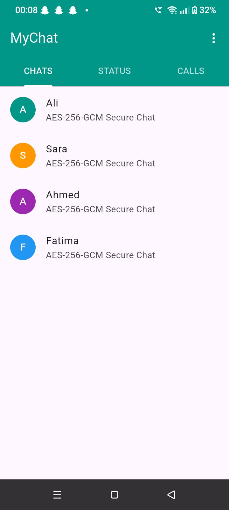
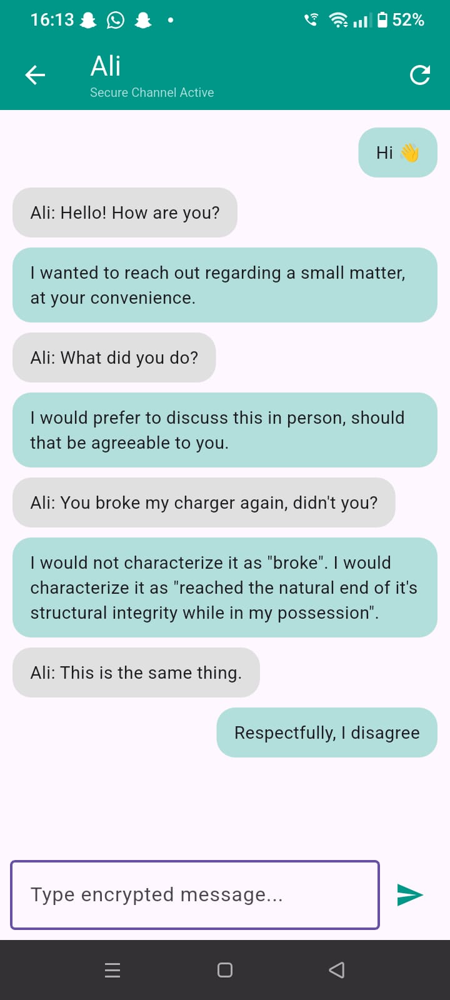
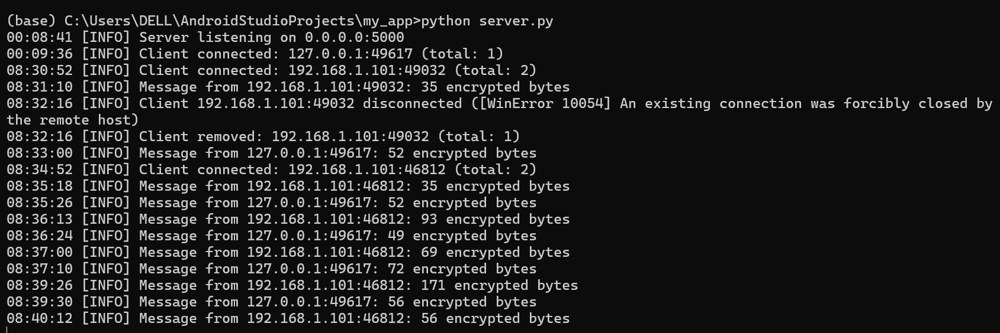
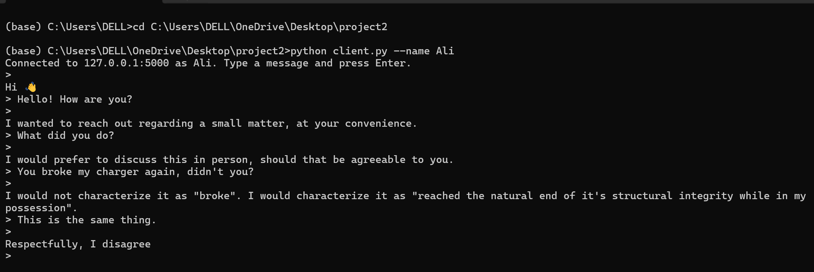

# Syntecxhub_Encrypted_Android_Chat

Encrypted chat prototype built for the **Syntecxhub Cyber Security Internship (Project 2: Encrypted Android Chat)**.
A Flutter Android client encrypts every message on the device with **AES-256-GCM** before sending it over a raw **TCP** socket to a multi-client Python server.

## Features

- **Client-side AES-256-GCM encryption and decryption**: Real-time encryption/decryption on the device.
- **Fresh random 12-byte nonce per message**: Prevents IV reuse attacks.
- **Authenticated encryption**: Tampered or corrupted messages fail the GCM tag check and are dropped.
- **Length-prefixed TCP framing**: Reassembles split or merged packets using a 4-byte big-endian header.
- **Multi-client Python server**: Handles concurrent connections with optional debug logging.
- **Secure Key Storage**: Key stored in the **Android Keystore** (via `flutter_secure_storage`), entered once on first launch and never kept in source code.
- **Message History**: Per-contact history persisted in secure storage (last 200 messages).
- **Basic UI & Error Handling**: Connection status indicators, reconnect button, and decryption-failure notices.

## Project Structure

```
.
├── lib/               # Flutter client source (main.dart)
├── server.py          # TCP chat server (multi-client, logging)
├── client.py          # CLI test client
├── crypto_utils.py    # AES-256-GCM logic for Python
├── assets/            # Demo screenshots
└── README.md
```

## Message Format

Each frame sent over the wire follows this layout:

```
[ 4-byte big-endian length ][ 12-byte nonce | ciphertext | 16-byte GCM tag ]
```

The length header covers only the encrypted payload. A pre-shared 256-bit key must be identical on both the client and server.

## Setup & Running

### 1. Server Setup
Run from the root directory:
```bash
pip install cryptography
python server.py            # Listens on 0.0.0.0:5000
python server.py --debug    # Also logs decrypted text (for testing only)
```
*Note: Find your computer's local IPv4 address using `ipconfig` (Windows) or `ifconfig` (Linux/macOS).*

### 2. Android App
1. Open the project in Android Studio.
2. In `lib/main.dart`, set `ServerConfig.host` to your server's IPv4 address.
3. **Firewall**: Ensure your computer's firewall allows incoming traffic on port 5000.
4. **Android SDK**: In `android/app/build.gradle`, set `minSdk` to **23** or higher (required by Keystore storage).
5. Install dependencies and run:
   ```bash
   flutter pub get
   flutter run
   ```
6. On first launch, enter the 256-bit shared key (64 hex characters). Use the top-right menu to reset the key/history.

### 3. CLI Client (Optional)
To test interaction without a second physical phone:
```bash
python client.py --name Ali
```

## Screenshots

### Android App
<p align="center">
  
  
</p>

### Server & Terminal Client
<p align="center">
  
  <br>
  <em>Server log showing encrypted/decrypted messages</em>
</p>

<p align="center">
  
  <br>
  <em>Terminal test client interaction</em>
</p>

## Security Notes and Key-Storage Risks

This is a learning prototype. Known limitations:

- **Pre-shared Key (PSK)**: The key is stored in the Android Keystore rather than source code, but it is manually shared. Anyone who obtains the key can read all captured traffic.
- **No Key Exchange**: A production system should use ephemeral key exchange (e.g., ECDH/X25519) to derive unique session keys with forward secrecy.
- **On-device Storage Risks**: On rooted devices, the key could potentially be accessed in memory while the app is running.
- **Server Trust**: The server currently holds the same key. In a true E2EE system, the server should never have access to cleartext or keys.
- **No User Authentication**: Any client with the key can connect and spoof identities.

## Tech Stack

- **Frontend**: Flutter / Dart (`cryptography`, `flutter_secure_storage`)
- **Backend**: Python (sockets, threading, `cryptography` library)
- **Protocol**: Custom length-prefixed TCP

## Author

Tooba - Syntecxhub Cybersecurity Internship, Week 2: Encrypted Chat App.
